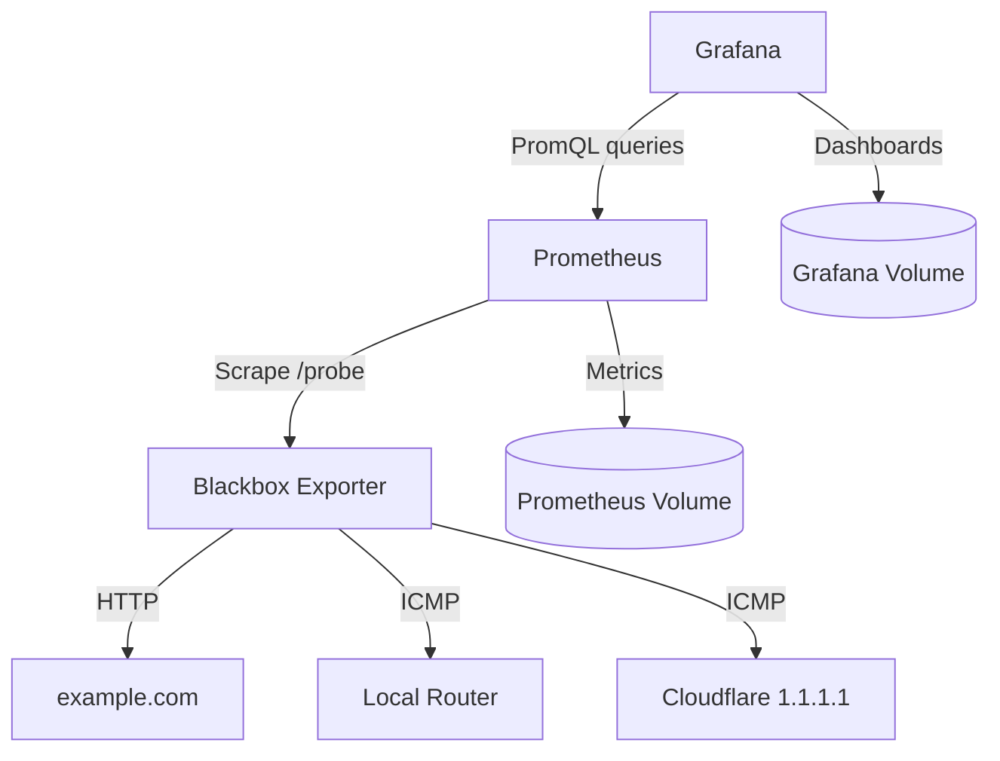

# Homelab Observability

A self-hosted monitoring lab built with Docker Compose,
Prometheus, Grafana, and Blackbox Exporter.

The project monitors HTTP availability, ICMP latency,
and failed network probes to help identify connectivity issues.

## Features

- HTTP availability monitoring
- ICMP monitoring of a local router and external host
- Network latency visualization
- Estimated packet loss monitoring
- Interactive Grafana dashboard
- Metrics collection every 15 seconds
- 7-day metrics retention
- Persistent storage using Docker volumes


## Architecture



## Requirements

- Docker Engine with Docker Compose v2, or Docker Desktop
- Available local ports: 3000, 9090, 9115
- Network access to the monitoring targets

## Getting Started

### 1. Clone the repository

```bash
git clone https://github.com/fikuslo/homelab-observability.git
cd homelab-observability
```

### 2. Configure monitoring targets

Edit `prometheus/prometheus.yml` and update the ICMP targets
to match your local network.

The default configuration monitors:

- `https://example.com` — HTTP availability
- `192.168.0.1` — local router (change if needed)
- `1.1.1.1` — external ICMP connectivity

### 3. Create persistent Docker volumes

```bash
docker volume create homelab-observability_prometheus_data
docker volume create homelab-observability_grafana_data
```

### 4. Start the monitoring stack

```bash
docker compose up -d
```

### 5. Verify the containers

```bash
docker compose ps
```

All three services should be running: Prometheus, Grafana,
and Blackbox Exporter.


## Accessing Services

After starting Docker Compose, open:

| Service | URL |
|---|---|
| Grafana | http://localhost:3000 |
| Prometheus | http://localhost:9090 |
| Prometheus Targets | http://localhost:9090/targets |
| Blackbox Exporter | http://localhost:9115 |

All web ports are bound to `127.0.0.1` and are not
directly exposed to other devices on the network.

## Grafana Configuration

### 1. Sign in

Open http://localhost:3000.

For a fresh Grafana installation, the default credentials
are typically `admin` / `admin`.

Change the default password when prompted.

### 2. Add Prometheus as a data source

Navigate to:

**Connections → Data sources → Add data source → Prometheus**

Configure:

- **Name:** Prometheus
- **Prometheus server URL:** `http://prometheus:9090`

Click **Save & test** to verify the connection.

The hostname `prometheus` resolves within the Docker Compose
network. Do not use `localhost:9090` as the data source URL
inside the Grafana container.

## Dashboard

The Network Observability dashboard configuration is stored in:

`grafana/dashboards/network-observability.json`

It includes four panels:

- Website Status
- HTTP Response Time
- ICMP Latency - Ping
- Packet Loss

The dashboard is exported in Grafana V2 Resource JSON format.

Note: The dashboard is not automatically provisioned by Docker
Compose. A fresh Grafana instance requires dashboard setup
or a compatible V2 import process.


## Troubleshooting

### Containers are not running

Check container status:

```bash
docker compose ps -a
```

Start the stack if needed:

```bash
docker compose up -d
```

### Prometheus target is DOWN

Open http://localhost:9090/targets and inspect the failing target.

Check Prometheus and Blackbox Exporter logs:

```bash
docker compose logs --tail=50 prometheus
docker compose logs --tail=50 blackbox
```

Note: A target marked UP means Prometheus successfully
collected metrics. Check `probe_success` to determine
whether the actual network probe succeeded.

### Grafana shows no data

Verify that the Prometheus data source uses:

`http://prometheus:9090`

Confirm that the data source connection test succeeds.

### External volume not found

The project requires two pre-created Docker volumes.
Follow the "Create persistent Docker volumes" instructions
before starting the stack.

Do not use `docker compose down -v` when you need
to preserve monitoring data.
