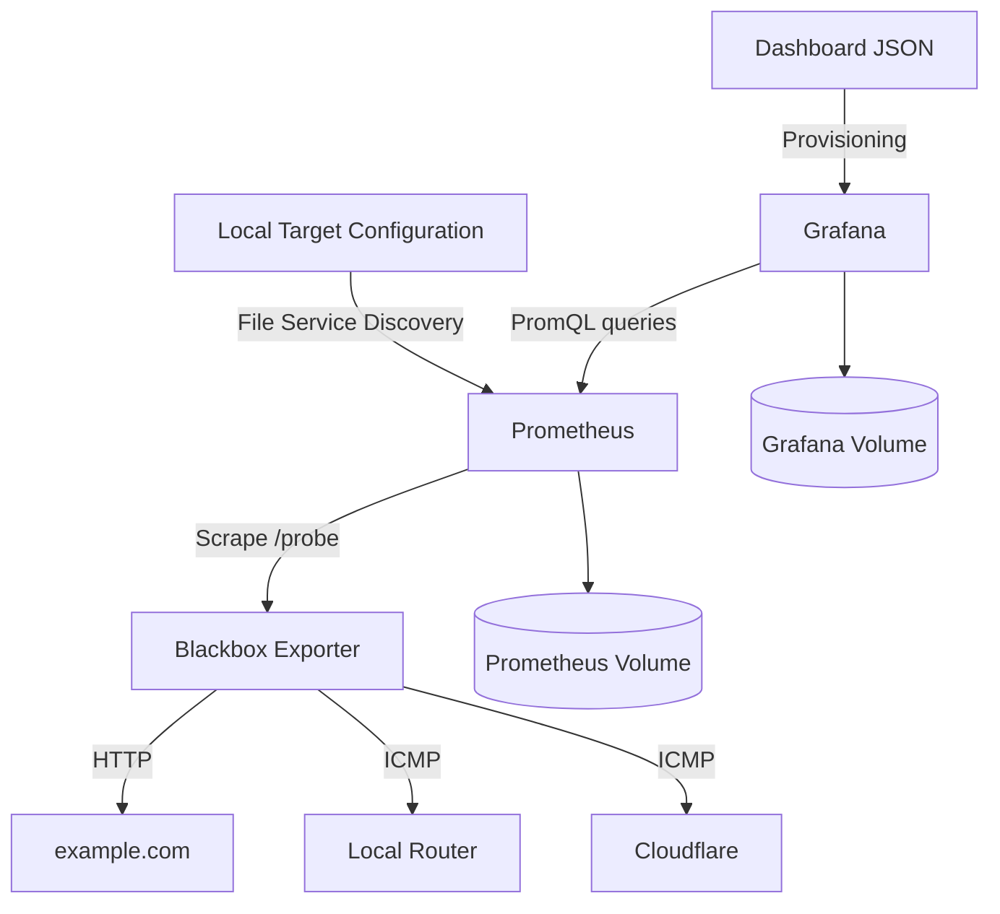

# Homelab Observability

A self-hosted network monitoring lab built with Docker Compose, Prometheus, Grafana, and Blackbox Exporter.

Designed to monitor network availability, latency, and failed connectivity probes with automated deployment and persistent storage.

## Features

- HTTP availability and response time monitoring
- ICMP latency monitoring
- Failed ICMP probe rate monitoring
- Automated Grafana data source and dashboard provisioning
- Prometheus File Service Discovery
- Separation of local and public configuration
- Metrics collection every 15 seconds
- 7-day metrics retention
- Persistent Docker volumes
- Local-only service access

## Architecture



## Requirements

- Docker Engine with Docker Compose v2, or Docker Desktop
- Available local ports: 3000, 9090, 9115
- Network access to monitoring targets

## Getting Started

### 1. Clone the repository

```bash
git clone https://github.com/fikuslo/homelab-observability.git
cd homelab-observability
```

### 2. Configure monitoring targets

```bash
cp prometheus/targets/icmp.example.yml prometheus/targets/icmp.local.yml
```

Edit `prometheus/targets/icmp.local.yml` and replace `YOUR_ROUTER_IP` with your router's IP address.

The local configuration file is excluded from Git.

Default monitoring targets:

- `https://example.com` — HTTP availability
- Local router — configurable ICMP target
- `1.1.1.1` — external ICMP connectivity

### 3. Create persistent Docker volumes

```bash
docker volume create homelab-observability_prometheus_data
docker volume create homelab-observability_grafana_data
```

### 4. Start the monitoring stack

```bash
docker compose up -d
```

### 5. Verify the deployment

```bash
docker compose ps
```

All three services should be running.

Open Grafana at http://localhost:3000.

For a fresh installation, the default credentials are `admin` / `admin`. Change the default password when prompted.

The Prometheus data source and Network Observability dashboard are provisioned automatically. No manual import is required.

## Accessing Services

| Service | URL |
|---|---|
| Grafana | http://localhost:3000 |
| Network Observability Dashboard | http://localhost:3000/d/adxkdl9/network-observability |
| Prometheus | http://localhost:9090 |
| Prometheus Targets | http://localhost:9090/targets |
| Blackbox Exporter | http://localhost:9115 |

All published ports are bound to localhost.

## Dashboard

The dashboard contains four panels:

| Panel | Description |
|---|---|
| Website Status | HTTP availability |
| HTTP Response Time | HTTP probe duration in milliseconds |
| ICMP Latency - Ping | Average ICMP round-trip time over 5 minutes |
| Packet Loss | Percentage of failed ICMP probes over 5 minutes |

The Packet Loss panel measures failed monitoring probes rather than continuous packet-level loss. Results may differ from native operating system ping measurements.

Dashboard configuration is stored in Grafana V2 Resource JSON format.

## Project Structure

```text
homelab-observability/
├── grafana/
│   ├── dashboards/
│   │   └── network-observability.json
│   └── provisioning/
│       ├── dashboards/
│       │   └── dashboards.yml
│       └── datasources/
│           └── prometheus.yml
├── prometheus/
│   ├── targets/
│   │   ├── icmp.example.yml
│   │   └── icmp.local.yml
│   └── prometheus.yml
├── .gitignore
├── compose.yaml
└── README.md
```

The `icmp.local.yml` file is created locally during installation and is not tracked by Git.

## Security and Privacy

- Services are bound to `127.0.0.1`.
- Personal monitoring targets are stored in an ignored local configuration file.
- Database files, backups, and local environment files are excluded from Git.
- Dashboard configuration is managed through provisioning.
- Default Grafana credentials should be changed after the first login.

## Configuration Validation

Validate Docker Compose:

```bash
docker compose config --quiet
```

Validate Prometheus configuration:

```bash
docker compose run --rm --no-deps \
  --entrypoint /bin/promtool prometheus \
  check config /etc/prometheus/prometheus.yml
```

## Troubleshooting

### Containers are not running

```bash
docker compose ps -a
docker compose logs --tail=50
```

### Prometheus target is DOWN

Open http://localhost:9090/targets and inspect the failing target.

Check the logs:

```bash
docker compose logs --tail=50 prometheus
docker compose logs --tail=50 blackbox
```

A target marked UP indicates successful metric collection. Use `probe_success` to determine whether a network probe succeeded.

### ICMP metrics are missing

Verify that `prometheus/targets/icmp.local.yml` exists and contains valid monitoring targets.

### Grafana shows no data

Verify that Prometheus is running and check Grafana provisioning logs:

```bash
docker compose logs grafana | grep -Ei 'provisioning|level=error'
```

The internal Prometheus URL must be `http://prometheus:9090`.

### External volume not found

Create both persistent Docker volumes before starting the monitoring stack.

### Stop the monitoring stack

```bash
docker compose down
```

Persistent external volumes retain monitoring data.

## Testing

Automated deployment was verified using an isolated Docker Compose project with fresh volumes and separate ports.

All four Grafana panels received metrics without manual data source configuration or dashboard import.

## Project Status

Version 1.0 — functional homelab monitoring project for practicing Linux administration, Docker, networking, infrastructure configuration, and observability.